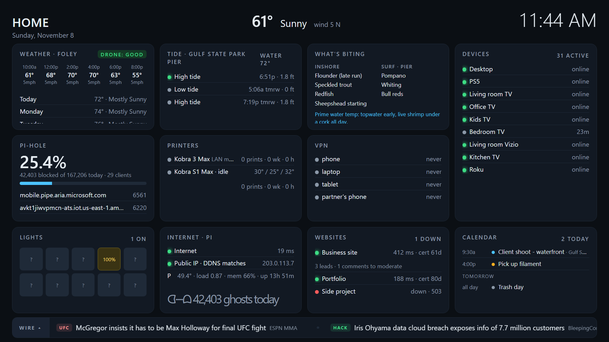
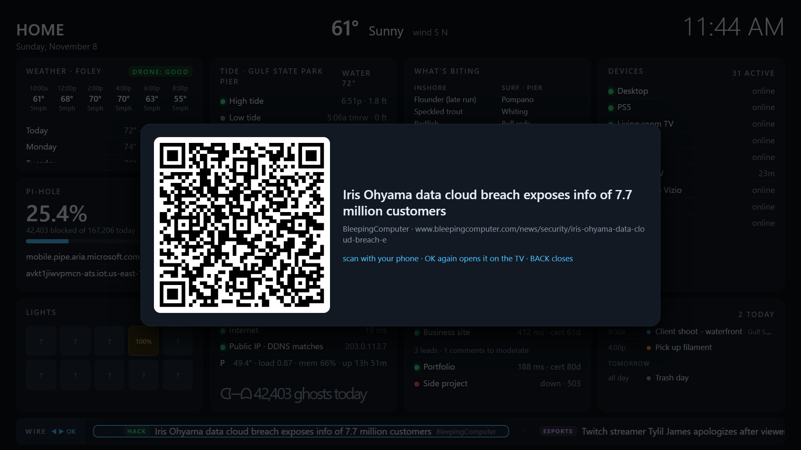

# housedash — a house dashboard for your TVs, served from a Raspberry Pi

One dark, TV-sized page with everything about the house on it, a news/UFC/esports/hacker wire scrolling along the bottom, and a Fire TV screensaver app that shows it whenever the TV is idle — with the remote's ◀ ▶ OK buttons driving the wire so you can actually open a headline (QR to your phone, or the TV's browser).



Everything is configured from a settings page on the Pi (no files to edit), and the whole thing is standard-library Python + one static HTML file, so it runs happily on a Pi Zero 2 W next to Pi-hole.

## What's on it

| Card | Source | Notes |
|---|---|---|
| **Weather** | api.weather.gov (NWS, no key) | hourly strip, 3-day, active alerts, and a **drone-flying verdict** (good / ok / windy) from the next 6 h of wind |
| **Tide** | NOAA CO-OPS (no key) | next 4 highs/lows for your station, water temperature |
| **What's biting** | built-in month table + rules | Alabama Gulf Coast by default; tips from water temp, wind and the next tide. Edit `BITING` in `outdoors.py` for your coast |
| **Devices** | Pi-hole's network table | online / last seen for the devices you name |
| **Pi-hole** | Pi-hole v6 API | blocked %, totals, top blocked, a Pac-Man "ghosts eaten" counter |
| **Printers** | Anycubic LAN mode (MQTT) | state, nozzle/bed/chamber, file, layer, progress, time left; lifetime / this-week / hours counters |
| **VPN** | `wg show` | WireGuard peers, green when they've handshaken recently |
| **Lights** | WiZ UDP + the Pi's own Bluetooth | on/off + brightness per WiZ bulb; on/off/colour for Zengge / Magic Home (`LEDnetWF`) and Magic Lantern (`MELK`, `ELK-BLEDOM`) Bluetooth strips, bars and bulbs - no app, no cloud |
| **Internet · Pi** | ping, ipify, DNS | latency/loss every 10 s, public IP vs your DDNS name, Pi temp/load/mem/uptime |
| **Websites** | HTTPS | up/down, response time, **TLS days left**, a **defacement fingerprint** of the home page; WordPress sites can add pending comments + Fluent Forms lead counts |
| **Calendar** | any iCal/ICS URL | today + tomorrow from Google / iCloud / Outlook secret iCal links — no OAuth, no Google Cloud project |
| **Flight brief** | FAA UASFM + Class Airspace layers, FAA TFR list, NOAA SWPC, Open-Meteo | airspace class and **LAANC ceiling** at your point, active **TFRs within N nm**, sunrise/sunset/golden hour, **Kp**, wind at 400 ft, and a GO / CAUTION / NO-GO verdict with reasons |
| **Radar · Tropics** | radar.weather.gov, NHC CurrentStorms | your NWS radar loop; active Atlantic systems (class, kt, mb, movement) with a push when a new one forms |
| **Security** | built-in | **honeypot** on ports nothing should touch (ftp/telnet/smb/rdp/vnc/mssql) with every hit logged + pushed; **nightly nmap audit** of the LAN diffed against the last run (new hosts, new open ports) |
| **The wire** | RSS + ESPN | UFC results & next card, hacker/infosec, esports, gaming, Hacker News, drones — every feed configurable, add your own |

Also folded into existing cards: **who's home** (phones by IP, home/away with "since") and **Wake-on-LAN buttons** on the Devices card; **PiSugar battery / mains** and an hourly **speed-test sparkline** on the Internet card; **rip-current risk** and the marine forecast on the Tide card; **domain expiry** (RDAP) next to the TLS days on Websites.

**Alerts** come in three layers: a banner + sound on every TV (new device loud, returning device a quiet chime, rate-limited, silent in quiet hours); a Windows **tray app** doing the same on your desk; and **push notifications** to your phone through [ntfy](https://ntfy.sh) — new device, someone home/away, print finished or errored, site down/back, page changed, cert or domain expiring, power lost/restored, honeypot hit, audit changes, new tropical storm. Each event has its own on/off switch on the settings page; quiet hours deliver silently.

**Controls** (phone/PC view, hidden on the TV): tap a bulb to toggle it, all-on / all-off, wake a PC; optional rule turns every light off when everyone has been away N minutes.



## Install (Pi)

Any Raspberry Pi running Raspberry Pi OS / Debian 12+. Pi-hole v6 is optional (the Pi-hole and Devices cards need it); WireGuard, WiZ bulbs and Anycubic printers are optional too — cards with nothing behind them just say so, or switch them off.

```bash
git clone https://github.com/Irak4t0n/housedash
sudo housedash/pi/install.sh
```

The installer pulls the few packages it needs, creates a venv for the printer and calendar libraries, asks for a Pi-hole app password (Pi-hole → Settings → Web interface/API → *Configure app password*), installs eight small systemd services and prints two addresses:

- **`http://<pi>:8088`** — the dashboard (what the TVs show)
- **`http://<pi>:8089`** — the settings page

Open the settings page and fill in what you have: house name, lat/lon (the NWS grid is resolved automatically), NOAA tide stations, printers / bulbs / devices / VPN peers by IP, websites, feeds. Changes reach the TVs within ~10 s. The two secrets — calendar iCal links and a WordPress application password — are entered on the same page and stored root-only; they're never displayed back.

Re-run `install.sh` to update after a `git pull`.

> The settings page has no login: it is meant for a home LAN (and your own VPN). Don't port-forward 8089. The `/api/*` actions (lights, wake) live on the same port for the same reason.

### Phone notifications
The settings page's **notify** section shows a private topic it minted for you. Install the ntfy app (Android/iOS), subscribe to that topic on `ntfy.sh` (or point `server` at your own ntfy), hit *Send a test*. Done — works on any network, no VPN needed. Don't share the topic: anyone with it can post to your phone.

### Bluetooth lights (Zengge, Magic Home, Magic Lantern)
Those cheap LED strips, light bars and bulbs that pair over Bluetooth instead of Wi-Fi work too, driven by the Pi's own radio (any Pi with built-in Bluetooth). Power them on, open the settings page -> **lights** -> *Scan for lights*, give each controller a name and Save. They show in the Lights card with on/off, join *all on / all off*, and the nobody-home rule turns them off with the WiZ bulbs. `housedash-blescan.timer` re-scans every 5 min so the card knows which ones are in range (~10 m). The phone app can't be connected at the same time as the Pi - close it if a command doesn't land. CLI for scripting: `/opt/housedash/venv/bin/python /opt/housedash/blelights.py color <mac> 255 40 0 60`.

### Optional: recursive DNS with Unbound
`sudo pi/extras/unbound-setup.sh` installs Unbound on `127.0.0.1#5335`, verifies it resolves and validates DNSSEC, then points Pi-hole at it — no upstream resolver sees your queries any more. The collector watches it; if Unbound stops answering, Pi-hole is switched back to Quad9 automatically and you get a push. `--undo` reverts.

### Sounds
`pi/web/sounds/` ships a generated chime (`returned.mp3`). Drop your own `newdevice.mp3` (and optionally `.ogg`) next to it for the new-device alert — the author uses a certain famous battle cry, which is not something to redistribute.

## The TV app (Fire TV / Android TV)

`tv-app/` is a 17 KB APK: one WebView, a **DreamService** (screensaver) and a launcher activity (for a Projectivy tile or "Your Apps").

- Screensaver stays up while you use **◀ ▶** to step through the wire; **OK** shows a QR code to scan with your phone; OK again opens the link in the TV browser; **Back** closes the popup, or wakes the TV. Any other button wakes the TV as usual.
- Retries every 15 s if the Pi is unreachable. **MENU** in the app opens a one-field URL setting.

Build (no Gradle; needs a JDK and Android build-tools 35 + platform 34):

```bash
cd tv-app
keytool -genkeypair -v -keystore housedash.keystore -alias housedash -keyalg RSA -keysize 2048 \
        -validity 10000 -storepass housedash -keypass housedash -dname "CN=housedash"   # once; keep it
DASH_URL=http://192.168.1.50:8088/ ./build.sh
adb connect <tv-ip>:5555 && adb install -r build/HouseDashboard.apk
adb shell settings put secure screensaver_components com.irak4t0n.housedash/.DashDream   # make it the screensaver
```

Works on Fire OS 7 (32-bit sticks) and Fire OS 8 TVs. Fire TV's own idle timeout (default 5 min) decides when it comes on.

## Roku TVs (screensaver channel)
Roku can't run the web page, so the Pi draws the dashboard to a PNG instead (`pi/render.py`, same cards, order and grid as the page, about 1 s of CPU per frame) and a tiny sideloaded Roku channel shows it as a screensaver, swapping frames only once the next one has loaded so it never blinks. Turn the renderer on under settings -> general -> *Roku screensaver*; the frame is served at `http://<pi>:8088/roku.png`.

On the TV, enable developer mode (Home x3, Up x2, Right, Left, Right, Left, Right -> Enable installer -> set a password -> restart), then from any machine with bash, zip and curl:

```
DASH_URL=http://192.168.4.99:8088/roku.png ROKU=<tv-ip> ROKU_PASS=<the password you set> roku/build.sh
# or on Windows:
roku\build.ps1 -DashUrl http://192.168.4.99:8088/roku.png -Roku <tv-ip> -RokuPass <the password you set>
```

Then Settings -> Screensaver -> **House Dashboard**. No remote interaction on this one (Roku screensavers close on any key), but everything else is there.

## PC tray alert (Windows)

`pc/newdevice-alert.ps1` polls the dashboard and plays the sounds / shows a toast on your desktop. It's a tray icon (right-click: status, mute 1 h, test, open dashboard, quit), launched at logon from your Startup folder with no console window. Set `$Pi` at the top, put your sounds in `pc/sounds/`, double-click `Install HouseDash alert.cmd`. `-Uninstall` removes it.

## How it's put together

```
pi/collect.py    every 10 s   Pi-hole API, wg show, device presence + new/returning logic, WiZ, Pi stats
pi/outdoors.py   10 s / 10 m  internet health / NWS + NOAA + fishing
pi/sites.py      every 20 s   websites
pi/ticker.py     every 5 m    the wire (RSS + ESPN scoreboard)
pi/gcal.py       every 5 m    iCal feeds
pi/printers.py   live         Anycubic LAN-mode MQTT (venv: anycubic-lan)
pi/canary.py     live         honeypot listeners -> security.json + push
pi/audit.py      nightly      nmap diff of the LAN (timer, hour configurable)
pi/speedtest.py  hourly       speedtest-cli history + sparkline (timer)
pi/flight.py                  FAA / SWPC / Open-Meteo / NHC / NWS-marine helpers used by outdoors.py
pi/notify.py                  ntfy push + local notification log
pi/wizctl.py                  WiZ bulb control (used by the API and the away rule)
pi/render.py                  draws the dashboard to roku.png for the Roku screensaver channel (roku/)
pi/blelights.py               Bluetooth LED controllers (Zengge/LEDnetWF, Magic Lantern/MELK) via bleak; scan + on/off/colour CLI
pi/setup.py      :8089        settings page + /api (wake, light, lights, notify test) -> /etc/housedash/config.json
pi/hdconfig.py                defaults + deep-merge; every service re-reads config each loop
pi/web/index.html             the page; polls state.json, auto-scrolls overflowing cards, runs the wire and TV remote mode
```

Each collector writes a small JSON file under `/var/lib/housedash/`; `collect.py` folds them (and the config) into `state.json`, which `python3 -m http.server` serves on 8088. No database, no framework, no build step. `qrcode.min.js` ([qrcode-generator](https://github.com/kazuhikoarase/qrcode-generator), MIT) is the only JavaScript dependency and is downloaded by the installer.

Secrets never go in `config.json`: Pi-hole password, calendar links and WordPress credentials live in `/etc/housedash/` as root-only files.

## License

MIT. Built by [Irak4t0n](https://github.com/Irak4t0n) for his own living room; PRs with new cards and feeds welcome.
